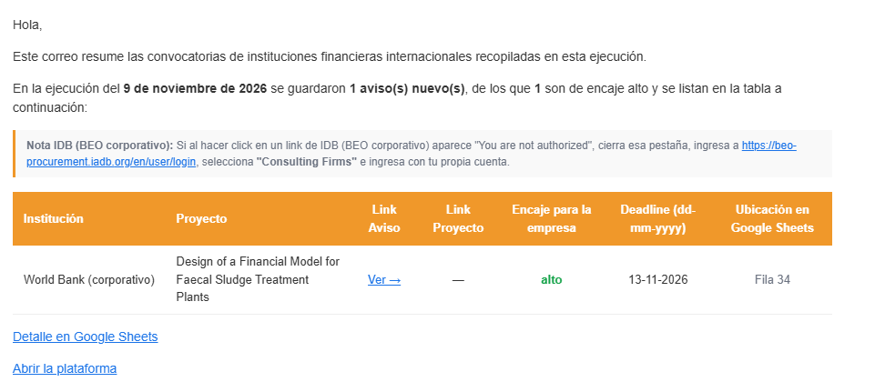
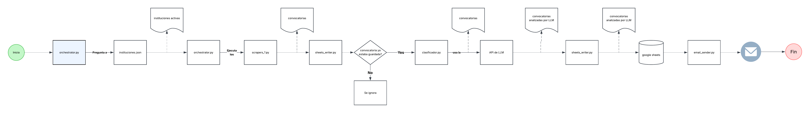

# Recolector de convocatorias

Recopila convocatorias de organismos internacionales, evalúa su encaje para una empresa con OpenAI, guarda los resultados en Google Sheets y envía un resumen por correo. Para empezar, descarga o clona el repositorio, configura tus credenciales y ejecuta backend y frontend en dos terminales siguiendo la [instalación local](#ejecutarlo-en-tu-computador).



## Cómo funciona

La página envía las instituciones seleccionadas a `POST /api/convocatorias/run` y recibe el progreso por SSE. El backend consulta los registros existentes, recopila avisos, omite los ya clasificados, clasifica y guarda los nuevos e intenta enviar el resumen.

<!-- Cuando agregues la imagen del flujo al repositorio, insértala aquí:

--

| Archivo del backend | Responsabilidad |
| --- | --- |
| [`main_api.py`](backend/main_api.py) | Recibe peticiones, transmite el progreso y solicita el correo final. |
| [`config.py`](backend/config.py) | Lee y valida variables de entorno y rutas. |
| [`instituciones.json`](backend/servicios/recolector_de_convocatorias/instituciones.json) | Define las fuentes y cuáles están activas. |
| [`orchestrator.py`](backend/servicios/recolector_de_convocatorias/orchestrator.py) | Coordina la consulta de duplicados, los scrapers, la clasificación y el guardado. |
| `scraper_*.py` en [`recolector_de_convocatorias/`](backend/servicios/recolector_de_convocatorias/) | Extraen y normalizan los datos de cada institución. |
| [`clasificador.py`](backend/servicios/recolector_de_convocatorias/clasificador.py) | Define el contexto empresarial y obtiene `encaje`: `alto`, `medio`, `bajo` o `descartable`. |
| [`ia.py`](backend/servicios/recolector_de_convocatorias/ia.py) | Comparte el cliente OpenAI y traduce los títulos de JBIC. |
| [`sheets_writer.py`](backend/servicios/recolector_de_convocatorias/sheets_writer.py) | Lee los registros existentes, valida las 16 columnas y guarda o actualiza filas. |
| [`email_sender.py`](backend/servicios/recolector_de_convocatorias/email_sender.py) | Envía el resumen HTML por SMTP; la tabla incluye solo avisos de encaje alto. |

Las clasificaciones fallidas pueden reintentarse; los registros antiguos sin clasificación válida se actualizan en su fila. Un fallo de lectura de duplicados detiene la ejecución. Ejecuta una recopilación a la vez contra la misma pestaña.

## Stack

- **Frontend:** Next.js 16, React 19, TypeScript y Tailwind CSS; NextAuth con Google para el modo producción.
- **Backend:** Python 3.11, FastAPI y Uvicorn; Requests, curl_cffi y BeautifulSoup para la extracción.
- **Integraciones:** SDK de OpenAI, gspread y oauth2client para Sheets, y smtplib para correo.
- **Despliegue opcional:** Docker, Cloud Run, Cloud Scheduler y Secret Manager.

## Ejecutarlo en tu computador

### 1. Preparar la configuración

Necesitas **Python 3.11** y **Node.js 22**. Abre PowerShell en la raíz del proyecto.

Copia las plantillas solo la primera vez; conserva los archivos si ya existen:

```powershell
Copy-Item backend/.env.example backend/.env
Copy-Item frontend/.env.example frontend/.env.local
```

Configura OpenAI y Google Sheets en `backend/.env`:

| Variable | Qué poner |
| --- | --- |
| `OPENAI_API_KEY` | Tu clave de OpenAI, con facturación y acceso al modelo. |
| `OPENAI_MODEL` | Modelo habilitado en tu cuenta; predeterminado: `gpt-6-luna`. |
| `SHEETS_CONVOCATORIAS_ID` | El ID de tu hoja: la parte entre `/d/` y `/edit` de su URL. |
| `SHEETS_TAB_NAME` | Pestaña de destino; predeterminado: `Convocatorias`. |
| `GOOGLE_APPLICATION_CREDENTIALS` | Ruta al JSON de tu cuenta de servicio; `credentials.json` apunta a `backend/credentials.json`. |

En tu proyecto de Google Cloud, habilita las APIs de Sheets y Drive, crea una cuenta de servicio y descarga su JSON. Comparte tu hoja con su `client_email` como **Editor**. Una pestaña nueva o vacía recibe los encabezados; una existente debe coincidir con las 16 columnas de `sheets_writer.py`.

Las demás variables de `backend/.env` son:

| Variables | Qué configurar |
| --- | --- |
| `GMAIL_USER`, `GMAIL_APP_PASSWORD`, `NOTIFY_EMAIL` | Remitente, [contraseña de aplicación de Gmail](https://support.google.com/accounts/answer/185833?hl=es) y destinatario. La contraseña requiere verificación en dos pasos. Vacíos desactivan el correo. |
| `SMTP_HOST`, `SMTP_PORT` | Para Gmail, conserva `smtp.gmail.com` y `465` (SMTP sobre SSL). |
| `BEO_EMAIL`, `BEO_PASSWORD` | Cuenta de Consulting Firm de BEO. Sin ella, usa `"activa": false` en `instituciones.json` y evita seleccionar BEO en la página. |
| `PORTAL_URL` | Enlace incluido en los correos; predeterminado: `http://localhost:3000`. Vacío lo omite. |
| `CORS_ORIGINS` | Orígenes permitidos del frontend; conserva los valores locales de la plantilla. |
| `ENABLE_AUTOMATION`, `SCHEDULER_SECRET` | Para uso manual, conserva `false` y el secreto vacío. |

En `frontend/.env.local`, configura:

```env
NEXT_PUBLIC_API_URL=http://localhost:8000
NEXT_PUBLIC_SHEETS_URL=https://docs.google.com/spreadsheets/d/ID_DE_TU_HOJA/edit
```

El enlace de Sheets es opcional y no concede permisos. Las variables `NEXT_PUBLIC_*` son visibles en el navegador: no incluyas secretos.

Adapta `_CONTEXTO_EMPRESA` en `clasificador.py`: contiene un ejemplo **ficticio** de BHP. `.env`, `.env.local` y `backend/credentials.json` son privados y están excluidos de Git.

### 2. Iniciar ambos servicios

En la primera terminal, desde la raíz:

```powershell
cd backend
py -3.11 -m venv .venv
.\.venv\Scripts\python.exe -m pip install -r requirements.txt
.\.venv\Scripts\python.exe -m uvicorn main_api:app --host 127.0.0.1 --port 8000 --reload
```

En una segunda terminal, también desde la raíz:

```powershell
cd frontend
npm ci
npm run dev
```

En macOS/Linux, usa `python3.11 -m venv .venv` y `.venv/bin/python` como ejecutable; npm no cambia.

### 3. Ejecutar una recopilación

Abre **http://localhost:3000**, sin login en desarrollo. Selecciona una institución y pulsa **Ejecutar seleccionadas**. Si configuraste correo, mantén la página abierta hasta ver el resultado del envío; también se envía sin novedades. Un fallo inicial de Sheets detiene el proceso antes del correo.

Después de instalar, repite solo Uvicorn y `npm run dev`. Reinicia al cambiar variables; detén con `Ctrl + C`. Recopilar puede consumir saldo de OpenAI. Los portales externos pueden cambiar y requerir ajustes.

## GCP y producción: opciones futuras

**Automatización del backend.** La [guía de GCP](docs/gcp.md) explica Cloud Run privado, Secret Manager y Scheduler con OIDC. Allí puedes usar `GOOGLE_CREDENTIALS_JSON` en lugar del archivo. Activa `ENABLE_AUTOMATION=true` solo tras configurar `SCHEDULER_SECRET` y el trabajo programado. La instalación local no crea recursos ni horarios.

**Frontend compilado.** `npm run build` y `npm start` requieren login Google, incluso localmente. Configura en `frontend/.env.local` tu cliente OAuth (`GOOGLE_CLIENT_ID`, `GOOGLE_CLIENT_SECRET`), la URL del frontend (`NEXTAUTH_URL`), un secreto de sesión aleatorio (`NEXTAUTH_SECRET`) y correos permitidos (`AUTH_ALLOWED_EMAILS`). `AUTH_ALLOWED_DOMAINS` permite dominios completos. Registra `URL_DEL_FRONTEND/api/auth/callback/google` en el cliente OAuth. Sin listas permitidas se rechaza el ingreso.

**Publicar la aplicación completa.** Hay Dockerfiles para ambos servicios. Configura los valores `NEXT_PUBLIC_*` al compilar y los secretos al ejecutar; ajusta URLs y CORS. Aún falta implementar la conexión autenticada entre el servidor del frontend y el backend privado: el login no protege la API manual. Conserva esa API privada. Las imágenes y el despliegue requieren verificación en tu entorno.
